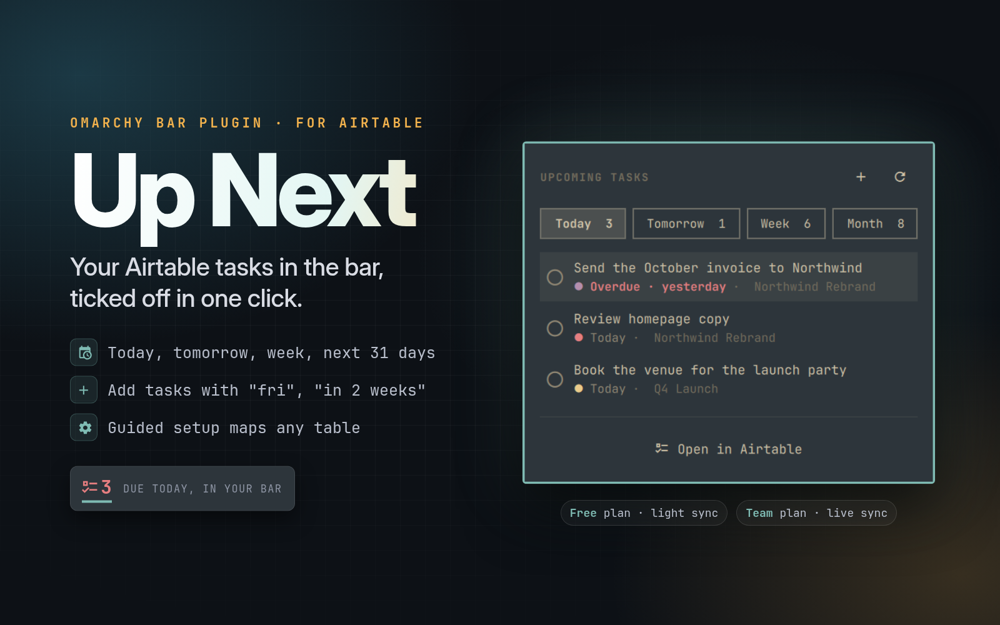
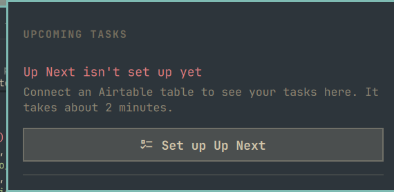

# Up Next

**Your Airtable tasks in the [Omarchy](https://omarchy.org) bar, ticked off in one click.**

[](https://github.com/SteveB98/omarchy-upnext/actions/workflows/ci.yml)
[](https://github.com/SteveB98/omarchy-upnext/releases)
[](LICENSE)
[](#free-or-team)

Up Next is an Omarchy bar plugin for Airtable. It shows how many tasks are due
today, opens a small panel with what's due today, tomorrow, this week and over
the next 31 days, and lets you tick tasks off or add new ones without opening
Airtable.



- **In the bar:** a checklist icon and the number of tasks due today. It turns
  red when something is overdue.
- **In the panel:** Today / Tomorrow / Week / Month tabs, overdue tasks first,
  priority dots and project names. Click the circle to mark a task done, or the
  trash icon (twice) to delete it.
- **Quick add:** type a name, pick a project and write the due date the way you
  would say it: `fri`, `in 2 weeks`, `next mon`, `oct 20`.
- **Any table:** a guided setup reads your base and matches its fields, so it
  works with the table you already have, or with the ready-made template.
- **Free or Team:** it adapts how often it syncs to your Airtable plan.

## Quick start

You need **Omarchy 4** and an **Airtable account** (the Free plan works).

1. **Get a task table.** Either use one you already have (it needs a name, a
   single-select status and a due date), or copy the template:
   **[Copy the Up Next template base](https://airtable.com/appa1EslGooZq8Kw2/shrnIFCICyixgdx9f)**.

2. **Install and turn on the plugin**, from the
   [Omarchy plugin marketplace](https://omarchyplugins.com) or with:

   ```bash
   omarchy plugin add https://github.com/SteveB98/omarchy-upnext --enable
   omarchy restart shell
   ```

3. **Connect it.** Click the new checklist icon in the bar, then
   **Set up Up Next**. A terminal opens and walks you through it (about 2
   minutes): create an Airtable token, pick your base and table, check the
   matched fields, and say which plan you're on.



The token needs three scopes, `data.records:read`, `data.records:write` and
`schema.bases:read`, and access to only the base that holds your tasks.

## Free or Team?

Airtable's **Free plan allows 1,000 API calls per workspace each month**, shared
by every tool connected to that workspace. Team and higher plans don't have that
cap in practice. Up Next picks a sync style to match:

| | Live (Team and up) | Light (Free) |
|---|---|---|
| Background refresh | every 5 minutes | every 30 to 120 minutes, paced so it uses at most half of the calls left this month |
| When you open the panel | always refreshes | refreshes if the list is over 10 minutes old |
| When you close the panel | refreshes | no call needed |
| Project list for quick add | refreshed every 10 minutes | refreshed every hour |
| Near the limit | n/a | above 80% of the month's calls, background refresh slows to every 2 hours |

On Light sync the panel shows how many calls Up Next has made this month. At
the start of a month that's a refresh about every 90 minutes; with calls to
spare late in the month it speeds up to every 30. Ticking, adding or deleting a
task always takes effect right away on either plan.

Airtable's API can't tell an app which plan a workspace is on, so setup asks
you. You can check under the workspace's **Billing** settings in Airtable. If
Airtable ever reports the monthly limit, Up Next switches itself to Light sync,
pauses background refreshes until the 1st (press `r` to try sooner) and tells
you, so it never keeps hammering a blocked workspace.

**My take:** I run Up Next on Airtable's Team plan. If your task base is where
you live all day, and other tools (automations, Zapier, scripts) use the same
workspace, Team is worth it: no monthly API cap, and the bar stays a few
minutes behind Airtable at most. If Up Next is your only integration, Free with
Light sync works fine: it paces itself to stay inside the allowance.

To switch later without running setup again:

```bash
~/.config/omarchy/plugins/io.github.steveb98.upnext/upnext plan team   # or: plan free
```

## Using it

| Do this | To |
|---|---|
| Left-click the icon | Open or close the panel |
| Middle-click the icon | Open straight into quick add |
| Right-click the icon | Open your table in Airtable |
| Click the circle on a task | Mark it done (click again to undo until the panel closes) |
| Click the trash icon, then again | Delete the task (the first click only asks) |
| Click anywhere else on a task | Open that task in Airtable |
| Scroll over the list | Flip pages |

**Keys** (with the panel open):

| Key | Action |
|---|---|
| `j` / `k`, arrows | Move between tasks (and on to the next page) |
| `h` / `l`, `1`-`4` | Switch tabs |
| `n` / `p`, `]` / `[` | Next / previous page |
| `Space`, `Enter` | Mark done / undo |
| `x` twice, or `Delete` twice | Delete the selected task |
| `o` | Open the task in Airtable |
| `a` | Open the table in Airtable |
| `+` or `c` | Add a task |
| `r` | Refresh now |
| `Esc` | Close (or leave the add form) |

### Open the panel from anywhere

Up Next doesn't add a system-wide shortcut, so it can't clash with yours. To
open your tasks with a key from any window, add a line to
`~/.config/hypr/bindings.lua`:

```lua
o.bind("SUPER + CTRL + U", "Up Next", "omarchy-shell io.github.steveb98.upnext toggle")
```

Use any free combination: press **Super + K** to see the shortcuts already in
use. The same command also takes `open` and `close` instead of `toggle`.

**Quick add** dates accept `today`, `tomorrow`, `fri`, `next fri`, `+3`,
`+2w`, `oct 20`, `20 oct`, `10/20` and `2026-10-20`, plus phrases like
`4 weeks from today`, `in 3 days`, `two weeks`, `a month from now`,
`1 week from tomorrow`, `next week` and `next month`. The line under each field
shows the date it will save. Name and Due are required. Typing a project name
that doesn't exist yet offers **+ New project**, which creates it in Airtable
first.

**What counts as a task:** anything in an "open" status (you pick these in
setup, for example Inbox, Next and In Progress) that has a due date. Today, Week
and Month mean "due by", so overdue tasks stay at the top until they're done.
Month is a rolling 31 days from today, not the calendar month.

## Settings

Add any of these to the widget's entry in `~/.config/omarchy/shell.json`:

```json
{ "id": "io.github.steveb98.upnext", "maxRows": 5, "syncMode": "Auto", "weekStart": "Monday" }
```

| Setting | Default | What it does |
|---|---|---|
| `maxRows` | `5` | Tasks per page. The panel keeps a full page's height so it never jumps. |
| `syncMode` | `"Auto"` | `Auto` follows the plan you picked in setup. `Light` or `Live` forces one. |
| `refreshIntervalSec` | `0` | Override the background refresh, in seconds. `0` is automatic. Live never goes below 300, Light never below 900. |
| `weekStart` | `"Monday"` | `Monday` or `Sunday`. Decides where the Week tab ends. |

## Use your own base

Setup works with any table that has:

- a **name** field (usually the primary field),
- a **single-select status**, with at least one "open" option and a "done" option,
- a **date** for when the task is due.

Optional extras it picks up if they're there: a **priority** single select
(ranked most urgent first, and setup flips Low-to-High lists), a **start date**,
and a **link to a projects table** (with that table's client, status and start
date). If your tasks table has a lookup of the project's name, Up Next uses it
and saves an API call per refresh.

Field and option names don't matter: setup matches by type and suggests the
likely field, and you confirm or change each one. Up Next stores field IDs, so
renaming a field in Airtable doesn't break it. Renaming or deleting a status
option does: run setup again if you change those.

## Troubleshooting

**The widget doesn't show up after installing.**
Run `omarchy restart shell`. If it's still missing, run
`omarchy plugin enable io.github.steveb98.upnext`.

**Setup says the token "can't read your bases' structure".**
The token is missing the `schema.bases:read` scope. Edit it on
[airtable.com/create/tokens](https://airtable.com/create/tokens) (the token
itself stays the same), then run setup again.

**"The token can't use this base".**
Edit the token and add your task base under **Access**.

**"Airtable's monthly API limit for this workspace is used up".**
The workspace is on the Free plan and has used its 1,000 calls for the month,
counting every tool connected to it. Up Next has switched to Light sync and
won't refresh in the background until calls reset on the 1st of the month
(press `r` to try sooner). See [Free or Team?](#free-or-team).

**The list is suddenly empty, or ticking a task says "Airtable said: ...".**
A status option you mapped in setup was renamed or removed in Airtable. Up Next
looks tasks up by status name, so run setup again from the panel. (Renamed
*fields* are picked up on their own.)

**"A field or status changed in Airtable".**
A field you mapped was deleted, or renamed while the token can't read the
base's structure. Run setup again from the panel.

**"No longer in Airtable".**
Someone deleted the task in Airtable since the list last refreshed, so Up Next
drops it from the list.

**"Airtable is busy (rate limit)".**
Too many requests reached the base at once, often from other tools. Up Next
tries again once after a minute. A tick or delete that failed is undone, so do
it again.

**A task I just added isn't in the list.**
It only shows if its status is one of your open statuses and it has a due date.

**Run setup by hand** (for example, if the panel button doesn't open a terminal):

```bash
~/.config/omarchy/plugins/io.github.steveb98.upnext/upnext setup
```

## Privacy and security

- The Airtable token is stored in your system keyring through `secret-tool`,
  never in a plain file. The field mapping lives in
  `~/.config/upnext/config.json` (owner-only), outside the plugin folder, so
  updating or removing the plugin doesn't touch it.
- Nothing private is passed on a command line, so other accounts on the same
  computer can't read it from the process list: not the token, and not what
  you type (task and project names, dates, statuses). The widget hands those
  to `upnext` on stdin, and `upnext` hands them to `curl` and `jq` the same
  way. The tests check this with canary values.
- The only network requests go to `api.airtable.com`. Links you click open
  `airtable.com` pages built from record IDs that are checked first.
- Status and field names are escaped before they go into Airtable formulas.
- Like every Omarchy plugin, this runs as unsandboxed code in the Omarchy
  shell. It's a small amount of code (`BarWidget.qml`, `DateParse.js`,
  `upnext`, `manifest.json`), so it's quick to read before you enable it. It
  never asks for admin rights, never installs packages, and never edits your
  configuration files.

## Dependencies

Everything below ships with a standard Omarchy install:

| Used for | Tools |
|---|---|
| The widget | Omarchy shell (Quickshell) |
| Talking to Airtable | `bash`, `curl`, `jq`, `secret-tool` (libsecret), `flock` (util-linux) |
| Setup | `xdg-open` (opens the token page), `gum` (nicer menus; optional) |

## Uninstall

```bash
~/.config/omarchy/plugins/io.github.steveb98.upnext/upnext forget   # removes the token, config and cache
omarchy plugin remove io.github.steveb98.upnext
```

You can also delete the token on
[airtable.com/create/tokens](https://airtable.com/create/tokens).

## How it works

- The widget never talks to Airtable itself. It runs the `upnext` script
  (bash, `curl` and `jq`), which prints one line of JSON per command. That keeps
  the network code small, testable and easy to read.
- One request fetches every open task with a due date. The tabs are local date
  windows over that list, so switching tabs is instant and costs nothing.
- Writes (done, undo, add, delete) happen immediately. A task you tick flips
  straight away and flips back if Airtable refuses. A refresh that overlaps a
  write is thrown away and run again after it, so the list never jumps back.
- Tests run offline with a fake `curl` and keyring: `tests/run.sh` and
  `node tests/date.test.mjs`.

Tested on Omarchy 4.0.6. The panel is built from Omarchy's own UI components,
so a future Omarchy update could need a plugin update.

## Contributing

Bug reports and ideas are welcome in
[Issues](https://github.com/SteveB98/omarchy-upnext/issues). See
[CONTRIBUTING.md](CONTRIBUTING.md) for running the tests. If Up Next earns a
spot in your bar, a star helps other Omarchy users find it.

## License

[MIT](LICENSE)
